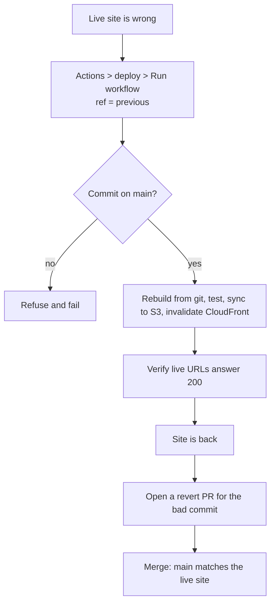

# Roll back pdlab.dev

To undo a bad deploy, run the `deploy` workflow with `ref` set to `previous`. It rebuilds the
commit before main's tip and deploys it in about three minutes. Then open a revert PR so main
matches the live site.

## Steps

1. Open **Actions > deploy > Run workflow**, from `main`.
2. Set `ref`:
   - `previous` deploys the commit before main's tip. Use this after one bad merge.
   - A SHA or tag deploys that commit. Use this to skip further back.
   - Blank deploys main's tip. Use it to redeploy without a rollback.
3. Approve the `production` environment if GitHub asks. Wait for the run to go green. The run
   ends by requesting every page on `pdlab.dev` and fails on any answer but 200.
4. Read the run summary. It names the commit deployed and says when this is a rollback.
5. Open a revert PR for the bad commit (`git revert <sha>`), and merge it. Until you do, the next
   merge to main deploys the bad commit's changes again, because they are still in main.

## How it works

- The workflow rebuilds from a git SHA. It stores no artifact, which keeps Actions storage small.
- The workflow refuses any commit that is not an ancestor of `origin/main`. The `production` key
  never builds code that skipped review.
- The build runs the commit's own tests. A commit that predates a page the deploy check expects
  fails the check before anything uploads, so roll back one deploy at a time.

## If the run fails

| Symptom | Cause | Fix |
|---|---|---|
| `is not on main` | The ref sits on a branch that never merged | Pick a SHA from `git log origin/main` |
| Build check names a missing file | The target predates a page the check requires | Revert the bad commit by PR instead |
| Live check answers non-200 | CloudFront still serves the old pages | Wait for the invalidation, then rerun |

## History

On 2026-11-18, promotion #102 shipped a broken build. It was undone by hand through revert PR
#103. This runbook replaces that manual path.
